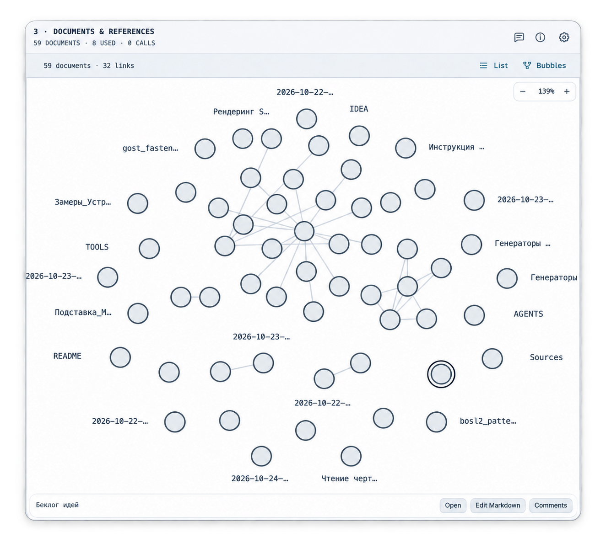

<div align="center">
  <a href="#возможности"></a><a href="#возможности"></a><a href="#подключение"></a><a href="#база-знаний-obsidian"></a><a href="#установка"></a>
</div>

<p align="center">
  
</p>

Интерактивный граф, который помогает следить за работой ИИ-агента: от запроса до результата. На нём видны зарегистрированные действия, инструменты, документы и рабочие файлы.

## Возможности

- Подключение Codex Desktop, Codex CLI, OMP и агента, встроенного в проект.
- Группировка сессий по проектам, между которыми можно переключаться. 
- История действий и пошаговый просмотр записанного маршрута.
- Документы и база знаний Obsidian, инструменты, MCP-серверы, навыки агента, сторонние системы памяти. 
- Рабочие файлы, результат, ошибки и расход токенов с разделением оценок и данных провайдера. В журнале агента доступны вкладки `/commands`, `/model` и `/session`: сведения о командах, модели и текущей сессии, если их передаёт подключённый агент. Вызовы `read`, `edit`, `bash` и других инструментов показываются с аргументами, статусом и результатом; вкладки не запускают команды.
- Терминал для каждой папки с вкладками процессов, связанных с проектом. Например, сервер сайта, запущенный через `npm run dev` и доступный по адресу `http://localhost:3000`, или локальный API памяти Hindsight, если подтверждена его связь с этой папкой. Для процесса видны команда запуска, рабочая папка, порт и доступные журналы.

<p align="center">
  <a href="docs/assets/agent-connections.png"></a>
  &nbsp;
  <a href="docs/assets/commands-panel.png"></a>
</p>

## Подключение

1. Откройте **Agent connections** — подключение агентов.
2. Выберите папку проекта и тип агента.
3. Запустите анализ папки и после его завершения создайте граф.
4. Выберите нужную сессию в списке слева.

Команды установки приведены [ниже](#установка), дополнительные инструкции — в [AGENTS.md](AGENTS.md).

> [!NOTE]
> Подключение агентов пока в бета-тестировании: не все варианты интеграции изучены и проверены, поэтому работа в каждом окружении не гарантируется. Если возникнут проблемы, попросите своего ИИ-агента помочь с подключением, передав ему инструкции из `AGENTS.md` и текст ошибки.

## База знаний Obsidian

Obsidian позволяет хранить заметки проекта в файлах Markdown и связывать их между собой. В такой базе можно собирать решения, требования, источники и другую информацию, к которой агент сможет обращаться при работе.

Подробнее о программе — на [сайте Obsidian](https://obsidian.md/) и в [официальной документации](https://obsidian.md/help/). Ниже — пример базы для контентного проекта:

```text
docs/knowledge/
├── ContentStrategy.md      # стратегия
├── Audience.md             # аудитория
├── VoiceAndStyle.md        # стиль
├── Channels.md             # площадки
├── Sources.md              # источники
├── EditorialWorkflow.md    # порядок работы
├── Decisions.md            # решения
├── ideas/
│   └── ContentIdeas.md     # идеи
├── publication/
│   └── PublicationQueue.md # очередь публикаций
└── analytics/
    └── Performance.md      # результаты
```

Это пример, а не обязательная структура: можно подключить собственные папки и заметки.

Если в инструкциях проекта настроена работа с базой, агент читает подходящие заметки перед задачей и самостоятельно дополняет их подтверждёнными сведениями по мере работы. Obsidian помогает просматривать и связывать эти заметки, а Observer показывает их структуру и выделяет зафиксированные обращения агента. Сам по себе граф не создаёт и не обновляет память.

<p align="center">
  <a href="docs/assets/document-map.png"></a><br>
  <sub>Документы и связи между ними</sub>
</p>

## Другие системы памяти

Кроме заметок проекта, агент может использовать отдельную память для сохранения и поиска опыта между сессиями. Например, в OMP доступны:

- **Hindsight** — память с поиском по сохранённым сведениям через отдельный сервис.
- **Mnemopi** — локальная память на базе SQLite.
- **Local summaries** — локальные сводки и уроки по проекту.
- **Sharpshooter** — файлы с решениями по архитектуре, продукту и стилю.

Observer показывает обнаруженные и настроенные системы памяти, их доступность и обращения, если они зафиксированы. Наличие системы в списке не означает, что агент использовал её в текущей сессии; доступные возможности зависят от агента и его настроек.

## Установка

**Требуется:**

- **Git**
- **Python 3.10 или новее**
- **Codex или OMP** — для подключения агента

### macOS

При необходимости установите зависимости через Homebrew: `brew install python git`. Затем в Терминале:

```sh
git clone https://github.com/Jas952/agent-observer.git
cd agent-observer
python3 -m venv .venv
.venv/bin/python -m pip install -r config/requirements.txt
.venv/bin/python observer.py run
```

Откройте в браузере **http://127.0.0.1:8766/**. Для повторного запуска из папки `agent-observer`: `.venv/bin/python observer.py run`.

### Windows — через WSL2

Требуется **WSL2 с Ubuntu**. Прямой запуск в Windows не поддерживается; работа через WSL2 пока не проверена.

В PowerShell от имени администратора:

```powershell
wsl --install -d Ubuntu
```

При запросе перезагрузите компьютер, откройте Ubuntu и выполните:

```sh
sudo apt update
sudo apt install -y git python3 python3-venv python3-pip lsof procps
git clone https://github.com/Jas952/agent-observer.git
cd agent-observer
python3 -m venv .venv
.venv/bin/python -m pip install -r config/requirements.txt
.venv/bin/python observer.py run
```

Откройте в браузере Windows **http://localhost:8766/**. Проект, агента и сервисы запускайте внутри Ubuntu; процессы Windows могут быть недоступны.
