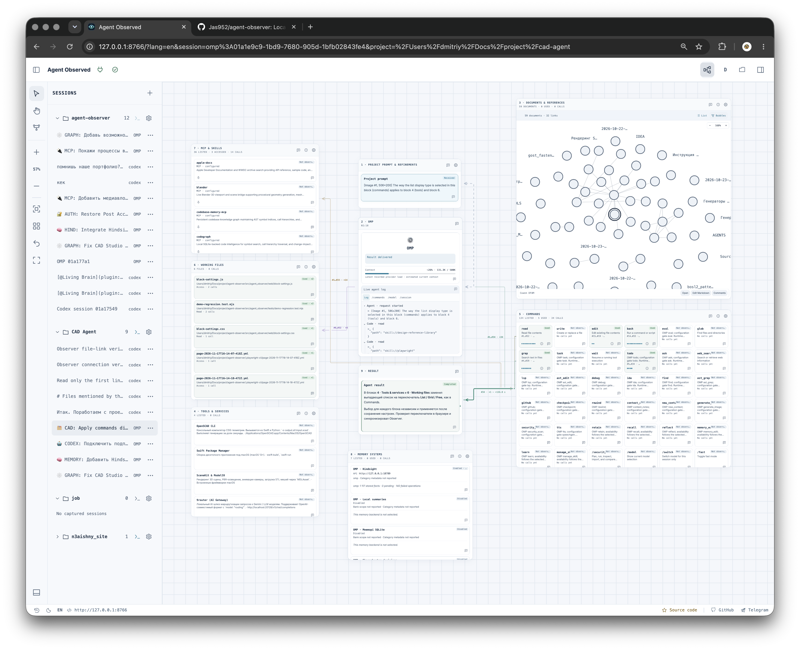
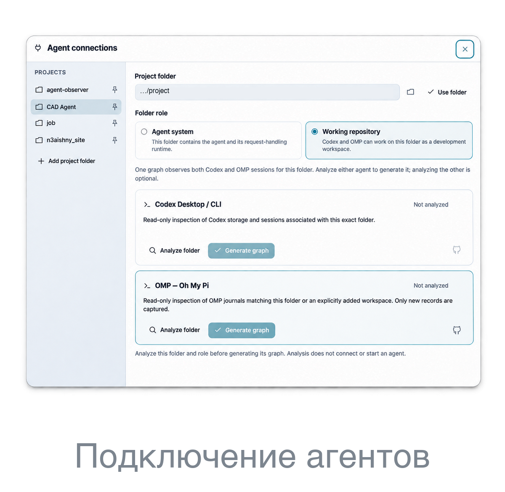
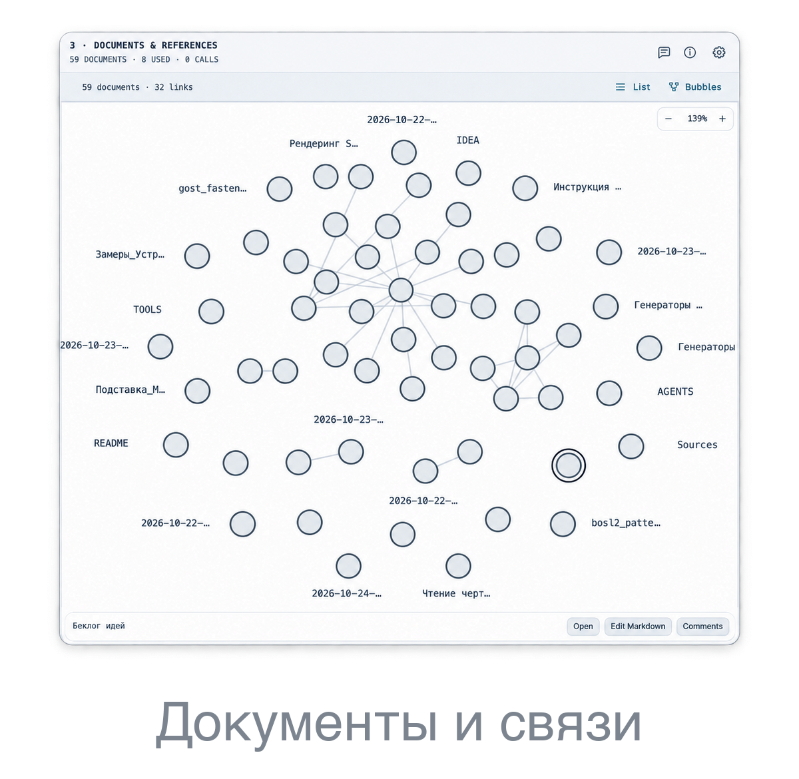

<div align="center">
  <a href="#возможности"></a><a href="#детали-интерфейса"></a><a href="#подключение"></a><a href="#база-знаний-obsidian"></a><a href="#установка"></a>
</div>

<p align="center">
  
</p>

Интерактивный граф, который помогает следить за работой ИИ-агента: от запроса до результата. На нём видны зарегистрированные действия, инструменты, документы и рабочие файлы.

## Возможности

- Подключение Codex Desktop, Codex CLI, OMP и агента, встроенного в проект.
- Несколько папок и графов: сессии сгруппированы по проектам, между ними можно переключаться. В одной папке доступны сессии Codex и OMP.
- История действий и пошаговый просмотр записанного маршрута.
- Документы и база знаний Obsidian, инструменты, MCP-серверы и навыки агента.
- Рабочие файлы, результат, ошибки и расход токенов с разделением оценок и данных провайдера. В журнале агента доступны вкладки `/commands`, `/model` и `/session`: сведения о командах, модели и текущей сессии, если их передаёт подключённый агент. Вызовы `read`, `edit`, `bash` и других инструментов показываются с аргументами, статусом и результатом; вкладки не запускают команды.
- Терминал для каждой папки с вкладками процессов, связанных с проектом. Например, сервер сайта, запущенный через `npm run dev` и доступный по адресу `http://localhost:3000`, или локальный API памяти Hindsight, если подтверждена его связь с этой папкой. Для процесса видны команда запуска, рабочая папка, порт и доступные журналы; вывод процесса из другого терминала может быть недоступен.

Граф показывает записанные события и не выполняет команды повторно. Наличие документа или инструмента в списке ещё не означает, что агент обращался к нему.

## Детали интерфейса

<p align="center">
  <a href="docs/assets/agent-connections.png"></a>
  &nbsp;
  <a href="docs/assets/commands-panel.png"></a>
  &nbsp;
  <a href="docs/assets/document-map.png"></a>
</p>

## Подключение

1. Откройте **Agent connections** — подключение агентов.
2. Выберите папку проекта и тип агента.
3. Запустите анализ папки и после его завершения создайте граф.
4. Выберите нужную сессию в списке слева.

Observer не меняет модель, настройки авторизации или историю агента. Команды установки приведены [ниже](#установка), дополнительные инструкции — в [AGENTS.md](AGENTS.md).

> [!NOTE]
> Подключение агентов пока в бета-тестировании: не все варианты интеграции изучены и проверены, поэтому работа в каждом окружении не гарантируется. Если возникнут проблемы, попросите своего ИИ-агента помочь с подключением, передав ему инструкции из `AGENTS.md` и текст ошибки.

## База знаний Obsidian

Граф показывает документы проекта и связанные заметки Obsidian. Например, база для контентного проекта может выглядеть так:

```text
docs/knowledge/
├── ContentStrategy.md      # стратегия
├── Audience.md             # аудитория
├── VoiceAndStyle.md        # стиль
├── Channels.md             # площадки
├── Sources.md              # источники
├── EditorialWorkflow.md    # порядок работы
├── Decisions.md            # решения
├── ideas/
│   └── ContentIdeas.md     # идеи
├── publication/
│   └── PublicationQueue.md # очередь публикаций
└── analytics/
    └── Performance.md      # результаты
```

Это пример, а не обязательная структура: можно подключить собственные папки и заметки. Файлы, к которым агент действительно обратился, выделяются на графе.

## Установка

Установка из исходников; отдельный установщик не требуется. Нужны Git и Python 3.10 или новее. Codex или OMP устанавливаются отдельно.

### macOS

Если используете Homebrew, зависимости можно установить командой `brew install python git`. Затем выполните в Терминале:

```sh
git clone https://github.com/Jas952/agent-observer.git
cd agent-observer
python3 -m venv .venv
.venv/bin/python -m pip install -r config/requirements.txt
.venv/bin/python observer.py run
```

Откройте **http://127.0.0.1:8766/**. Для повторного запуска достаточно последней команды из папки `agent-observer`.

### Windows — через WSL2

Прямой запуск в Windows пока не поддерживается: код использует Unix-механизмы управления процессами. Ниже — вариант для WSL2 с Ubuntu; сквозная работа в этом окружении пока не проверена.

В PowerShell от имени администратора:

```powershell
wsl --install -d Ubuntu
```

Если система попросит, перезагрузите компьютер. Откройте Ubuntu, завершите первоначальную настройку пользователя и выполните:

```sh
sudo apt update
sudo apt install -y git python3 python3-venv python3-pip lsof procps
git clone https://github.com/Jas952/agent-observer.git
cd agent-observer
python3 -m venv .venv
.venv/bin/python -m pip install -r config/requirements.txt
.venv/bin/python observer.py run
```

Откройте **http://localhost:8766/** в браузере Windows. Для этого варианта запускайте проект, агента и связанные сервисы внутри той же Ubuntu: процессы и журналы приложений Windows могут быть недоступны из WSL.

## Проверка

```sh
PYTHONPATH=src .venv/bin/python -m unittest discover -s src/agent_observer/tests -p 'test_*.py'
node --test --test-concurrency=1 src/agent_observer/tests/demo-regression.test.mjs src/agent_observer/tests/omp-results.test.mjs
```
