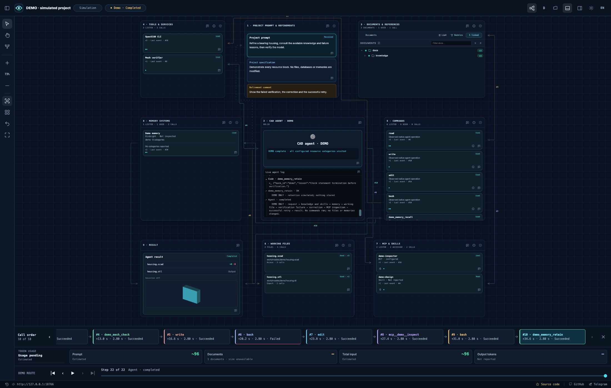

# Agent Observer

Интерактивный граф, который помогает следить за работой ИИ-агента: от запроса до результата. На нём видны зарегистрированные действия, инструменты, документы и рабочие файлы.



## Возможности

- Подключение Codex Desktop, Codex CLI, OMP и агента, встроенного в проект.
- Несколько папок и графов: сессии сгруппированы по проектам, между ними можно переключаться. В одной папке доступны сессии Codex и OMP.
- История действий и пошаговый просмотр записанного маршрута.
- Документы и база знаний Obsidian, инструменты, MCP-серверы и навыки агента. MCP — способ подключить к агенту внешние инструменты и сервисы.
- Рабочие файлы, результат, ошибки и расход токенов. Токены — единицы, в которых измеряется объём текста для модели.
- Терминал для каждой папки. В нём можно видеть обнаруженные процессы проекта, например локальный сайт или службу памяти, и их журналы, если они доступны.

Граф показывает записанные события и не выполняет команды повторно. Наличие документа или инструмента в списке ещё не означает, что агент обращался к нему.

## Подключение

1. Откройте **Agent connections** — подключение агентов.
2. Выберите папку проекта и тип агента.
3. Запустите анализ папки и после его завершения создайте граф.
4. Выберите нужную сессию в списке слева.

Observer не меняет модель, настройки авторизации или историю агента. Инструкции по установке и запуску находятся в [AGENTS.md](AGENTS.md).

## База знаний Obsidian

Граф может показывать документы проекта, в том числе заметки Obsidian — программы для ведения связанных заметок. Например, база для контентного проекта может выглядеть так:

```text
docs/knowledge/
├── ContentStrategy.md      # стратегия
├── Audience.md             # аудитория
├── VoiceAndStyle.md        # стиль
├── Channels.md             # площадки
├── Sources.md              # источники
├── EditorialWorkflow.md    # порядок работы
├── Decisions.md            # решения
├── ideas/
│   └── ContentIdeas.md     # идеи
├── publication/
│   └── PublicationQueue.md # очередь публикаций
└── analytics/
    └── Performance.md      # результаты
```

Это пример, а не обязательная структура: можно подключить собственные папки и заметки. Файлы, к которым агент действительно обратился, выделяются на графе.

## Проверка

```sh
PYTHONPATH=src .venv/bin/python -m unittest discover -s src/agent_observer/tests -p 'test_*.py'
node --test --test-concurrency=1 src/agent_observer/tests/demo-regression.test.mjs src/agent_observer/tests/omp-results.test.mjs
```
