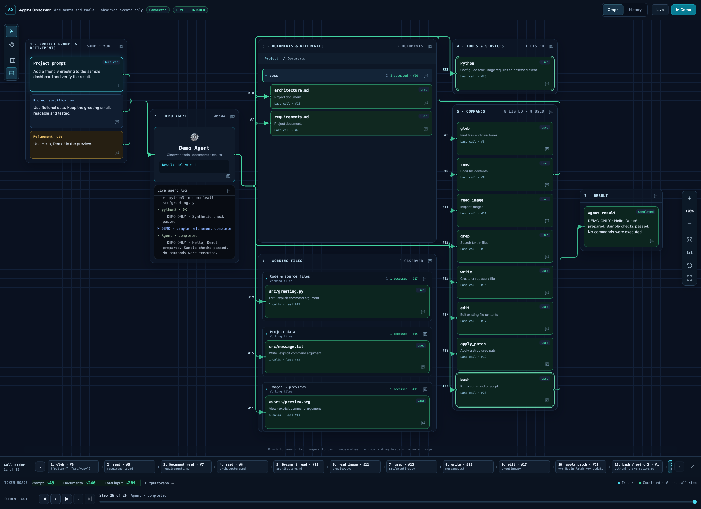

# Agent Observer

Отдельный локальный инструмент, который показывает **наблюдавшийся путь агента от запроса до результата**: документы, команды, инструменты, рабочие файлы, публичные сообщения о ходе работы и токены. CAD Agent — первая интеграция, а не обязательная архитектура проекта.

**Obsidian, `docs/knowledge`, Phoenix и база данных не обязательны.** В разделе документов показаны обычные файлы из подключённых источников. Каталог не доказывает чтение: подсветка появляется только по событию агента.



На скриншоте — **только вымышленные данные**, полный цикл из 26 событий уже завершён. Зелёные выделения показывают успешные обращения; номера на связях помогают восстановить порядок вызовов.

- **Запрос → агент → результат:** промпт, требования и уточнения связаны с итогом работы.
- **Документы и рабочие файлы:** видно, к каким файлам обращались и через какие команды.
- **Инструменты и команды:** вызовы, аргументы, результаты и ошибки доступны в журнале и инспекторе.
- **История и воспроизведение:** маршрут можно просмотреть по шагам и вернуться к конкретному вызову.
- **Токены:** оценки по тексту отделены от usage провайдера; неизвестные значения остаются пустыми.

### Попробовать на тестовых данных

В корне репозитория после установки зависимостей запустите:

```bash
.venv/bin/python observer.py run
```

Откройте [тестовый граф](http://127.0.0.1:8766/), затем во втором терминале выполните:

```bash
.venv/bin/python examples/replay_demo.py
```

Поставляемый профиль подключает только `examples/demo-project/docs`. Сценарий отправляет **синтетические события** с тестовыми именами файлов, не выполняет показанные команды и не вызывает модель. Это демонстрация интерфейса, а не проверка интеграции агента. Реальные проекты подключаются отдельно по инструкции ниже.

## 1. Подключить проект

Из корня скачанного репозитория:

```bash
python3 -m venv .venv
.venv/bin/python -m pip install -r config/requirements.txt
.venv/bin/python observer.py install "/path/to/project"
.venv/bin/python observer.py run --config "/path/to/project/.agent-observer/config/observer.project.json"
```

Откройте [локальный граф](http://127.0.0.1:8765/). Для другого порта измените `port` в настройках установки. Один запущенный сервер обслуживает одну конфигурацию проекта; независимым проектам задайте разные порты. Внутри проекта возможны разные агенты и независимые run ID.

Установка создаёт `.agent-observer/` с пакетом в `src/` и отдельным `config/observer.project.json`. Она не меняет поведение агента автоматически: его точки вызова нужно подключить по [промпту внедрения](docs/prompts/INTEGRATE.md). Автоматического доступа к скрытым рассуждениям модели нет.

Для уже установленного CAD Agent:

```bash
.venv/bin/python observer.py run --config "../cad-agent/.agent-observer/config/observer.project.json"
```

Сам инструмент можно открыть отдельно: `.venv/bin/python observer.py run` — [порт 8766](http://127.0.0.1:8766/), тестовый профиль из `config/observer.project.json`. Этот профиль не копируется в установки.

Совместимый запуск из CAD-проекта остаётся доступным: `python scripts/xray_server.py`. Если порт уже занят работающим графом, второй сервер на этом порту запускать не нужно.

## 2. Что настроить

- **Документы:** произвольные папки и файлы в `documents`; [подробная инструкция](docs/README.md). Папки смешанного состава допустимы. Менять структуру проекта не требуется.
- **Инструменты и службы:** `tools` и их явные имена/префиксы команд. SQL, HTTP, shell, компилятор или другой агент могут быть ресурсом; каталог не проверяет их наличие и не обращается к ним самостоятельно.
- **Адаптер агента:** события `PROMPT_START`, `TOOL_CALL_START/END`, `KNOWLEDGE_ACCESS`, публичные фазы, usage и `GENERATION_END`. См. [контракт событий](docs/EVENTS.md) и [пример Python](examples/instrumented_agent.py).
- **Личные данные:** конфигурация проекта, история, токен и реальные документы принадлежат установке. Не включайте токены, пароли и полный чувствительный вывод в события. По умолчанию передаются короткие описания.
- **Пример настроек:** [observer.project.example.json](config/observer.project.example.json). История и токен разных проектов хранятся раздельно в Application Support/AgentObserver (Linux: `~/.local/share/AgentObserver`). Профиль `cad-studio` сохраняет существующие пути CAD Studio.

## 3. Обновления: один исходник, несколько установок

**Общий исходник находится здесь.** Реестр установок: `.observer/installations.json`. Установленные копии не являются отдельными ветками инструмента.

```bash
.venv/bin/python observer.py sync
.venv/bin/python observer.py status
```

Для автоматической синхронизации во время редактирования:

```bash
.venv/bin/python observer.py watch
```

Watcher сравнивает файлы каждую секунду. Команда `observer.py run` запускает такой watcher вместе с сервером. Остановка watcher не удаляет установки; `sync` остаётся доступным вручную. Watcher не настраивает автозапуск при входе в систему.

При синхронизации обновляются общий код, интерфейс и поставляемые инструкции. **Настройки проекта, история, токен, документы, комментарии и расстановка графа не копируются между проектами.** Предыдущие версии изменяемых файлов сохраняются в `.observer-backups/`. Если установленный файл отредактирован отдельно, синхронизация останавливается до переноса изменений в общий исходник.

HTML подхватывается после обновления страницы. Изменения Python-сервера требуют его перезапуска; watcher не прерывает работающий запрос. Правило синхронизации после правок закреплено в [AGENTS.md](AGENTS.md).

## 4. Как читать граф

Промпт и требования ведут к агенту; стрелки показывают наблюдавшиеся обращения. **Call order** — порядок вызовов с переходом к конкретному событию и команде. История хранит запрос, приложения, обращения и результат в пределах настроенных `max_steps`/`max_runs` (по умолчанию 5000/50).

Статусы: In use — выполняется; Used — получен успешный результат; Failed — ошибка; Called — вызов известен, результат не получен. Категория документов сохраняет исходную иерархию папок. Working files собирает явно переданные пути из команд, а не упоминания в тексте программы.

Токены расположены под графом: `~` означает оценку по тексту; без `~` — данные провайдера. Неизвестный output не заменяется нулём. Значения input суммируются по обращениям к модели, поэтому повторно отправленный контекст учитывается повторно.

Во время работы по сплошной стрелке медленно проходит световой акцент и подсвечивается рамка блока. Завершение/ошибка даёт короткий зелёный/красный эффект. При масштабировании анимация приостанавливается; поддерживается системное уменьшение движения. Demo не выполняет команды проекта и использует вашу расстановку блоков.

## Структура папки

```text
Agent Observer/
  observer.py                 # команда управления
  README.md                   # начало работы
  AGENTS.md                   # правила развития инструмента
  src/agent_observer/         # сервер, клиент, конфигурация и web/dashboard.html
  config/                     # зависимости и профили проектов
  docs/                       # инструкции, prompts/, assets/ и reports/
  examples/                   # пример подключения агента
  integrations/cad-agent/     # совместимые точки запуска CAD
  var/                        # локальные журналы, кеш и архив прежних файлов
```

`var/` содержит только локальные данные и исключён из Git. Истории, токены, реестр установок `.observer/`, резервные копии и файлы окружения также исключены. Не добавляйте личные документы и чувствительные аргументы в публичные примеры или события. Рабочая история CAD по-прежнему находится в Application Support/CADStudio.

Установка в проекте повторяет эту структуру внутри `.agent-observer/`. Для CAD в `scripts/` остаются только два совместимых входа `xray_server.py` и `xray_auth.py`; их код и метаданные также обновляются общей синхронизацией.

### Управление полем графа

Масштаб и Fit расположены вертикально справа; выбор, перемещение и переключатели панелей — в одной панели слева. Щипок тачпада масштабирует граф под курсором; движение двумя пальцами перемещает поле, а внутри списка прокручивает список. Колесо мыши над пустым полем меняет масштаб. Режим перемещения позволяет перетаскивать поле также поверх карточек.

Крестик справа в панели последовательности вызовов скрывает нижнюю область с токенами и проигрывателем. Кнопка Route details в левой панели возвращает её. Инспектор закрывается своим крестиком и возвращается кнопкой Inspector в той же левой панели; выбор сохраняется для проекта. Скрытый за прокруткой адресат стрелки показывается компактной карточкой у верхнего или нижнего края категории. Нажатие возвращает к исходному блоку.

Панель инструментов слева: выбор (V), перемещение (H), инспектор и нижняя область маршрута. Вертикальная панель вида справа: уменьшить/увеличить масштаб, меню процентов, вписать граф (0), 1:1 (1), сбросить раскладку и полный экран. Размер каждой группы меняется за правый нижний угол; размеры сохраняются отдельно от её положения. Сброс раскладки возвращает исходные размеры и позиции.

### Компоновка и клавиатура

Graph и History объединены в переключатель в шапке; Live и Demo находятся рядом как действия. Кнопки боковых панелей остаются на постоянных местах после скрытия инспектора или нижней области. На узком экране инспектор открывается поверх поля; на низком — боковые панели и меню процентов прокручиваются в своих границах. Полноэкранный режим сохраняет шапку и область маршрута.

В боковых панелях клавиши ↑/↓, Home и End переводят фокус между кнопками. Escape закрывает проценты и возвращает фокус; выбор процента также возвращает фокус кнопке масштаба. Fit оставляет место боковым панелям. Расстановка блоков, камера и наблюдавшаяся история сохраняются.

### Команды и комментарии

Commands содержит восемь стандартных шаблонов: glob, read, read_image, grep, write, edit, apply_patch и bash. Весь список виден без внутренней прокрутки; высота блока определяется содержимым. Алиасы одного действия подсвечивают общий блок; точное имя вызова, аргументы и результат доступны в журнале и инспекторе. Дополнительный тип команды добавляет собственную карточку только после зафиксированного TOOL_CALL_START/TOOL_CALL_END в текущем маршруте. Упоминание имени команды в тексте или наличие её в доступных инструментах не создаёт карточку.

Иконка комментария находится в заголовке группы или папки и в нижнем правом углу карточки. Она открывает отдельное окно с сохранёнными заметками и редактором. Copy prompt копирует заметку вместе с контекстом маршрута, блока и зафиксированной активности. Старые заметки сохраняются; заметки к прежним именам команд доступны у соответствующего шаблона.

При изменении размера группы её края и размеры привязываются к соседним группам. Пунктирные направляющие показывают привязку; Alt временно отключает её. Documents имеет фиксированный размер и не растягивается вручную. Commands допускает изменение ширины, а высота автоматически охватывает весь список. В растянутом блоке агента карточка и лог делят внутреннюю высоту в пропорции 3:4.

Привязка работает при перемещении всей группы и при растягивании за любой из восьми краёв/углов. Она сопоставляет края, центры и размеры всех остальных групп; подсветка показывает цель, подписанный пунктир — совпавшее направление. Для Commands доступны только левый и правый края, поскольку высота определяется списком; Documents можно перемещать, но нельзя растягивать. Alt временно отключает привязку.

Прокрутка использует тонкий индикатор поверх содержимого без выделенного места справа. Он появляется при прокрутке, скрывается после паузы и поддерживает перетаскивание, нажатие на дорожку и управление стрелками с клавиатуры. Левые и правые отступы области данных одинаковы.

Маршруты стрелок выбирают стороны выхода и входа по расположению блоков: связи вправо обычно идут справа налево, обратные — слева направо. Для групп в одной колонке выбирается общий боковой коридор. Поиск пути учитывает препятствия и стоимость лишних изгибов. Выбранный маршрут фиксируется для пары блоков при неизменной геометрии поля; прокрутка меняет только локальную привязку. Непроверенный произвольный обход через весь граф не используется.
