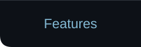
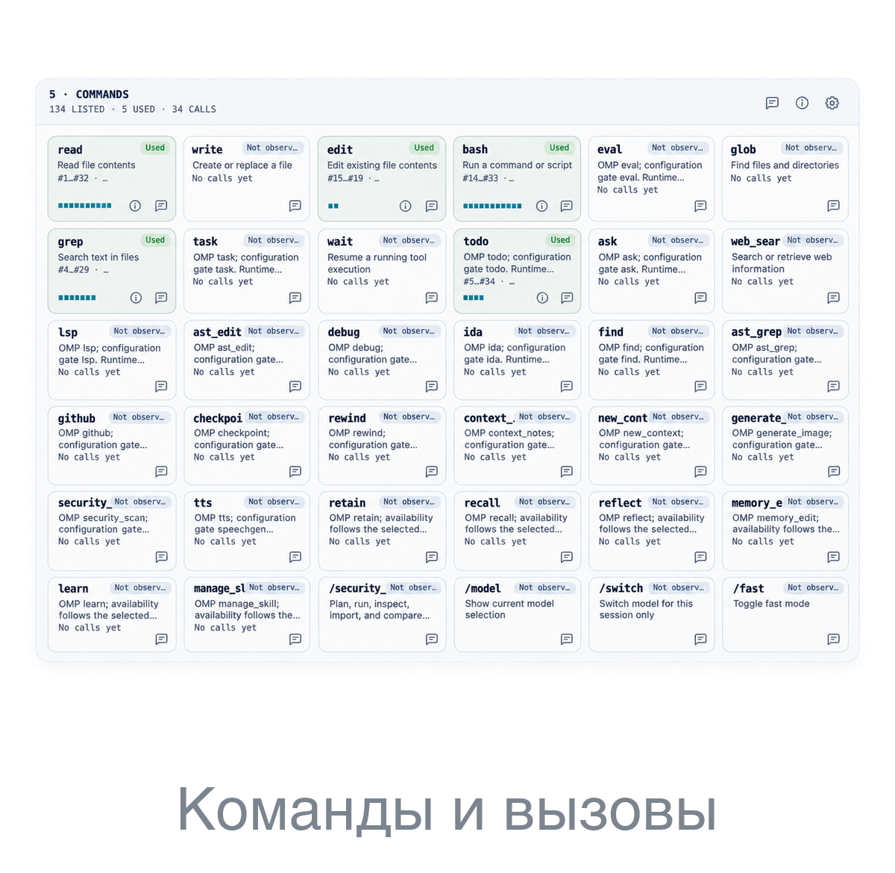

<div align="center">
  <a href="#features"></a><a href="#features"></a><a href="#connecting-agents"></a><a href="#obsidian-knowledge-base"></a><a href="#installation"></a>
</div>

<p align="center">
  
</p>

An interactive graph that helps you track how an AI agent works, from the initial request to the final result. It visualizes recorded actions, tools, documents, and working files.

## Features

– Connect Codex Desktop, Codex CLI, OMP, and agents embedded in a project.
– Group sessions by project and switch between projects.
– Explore the activity history and review the recorded execution path step by step.
View documents, Obsidian knowledge bases, tools, MCP servers, agent skills, and third-party memory systems.
– Inspect working files, results, errors, and token usage, distinguishing estimates from provider-reported data. The agent log includes /commands, /model, and /session tabs with information about commands, the model, and the current session when the connected agent provides it. Calls to read, edit, bash, and other tools are displayed with their arguments, status, and results. These tabs do not execute commands.
– Access a terminal for each project folder, with tabs for project-related processes. Examples include a web server started with npm run dev and available at http://localhost:3000, or a local Hindsight memory API if its association with the folder has been confirmed. Each process displays its launch command, working directory, port, and available logs.

<p align="center">
  <a href="docs/assets/agent-connections.png"></a>
  &nbsp;
  <a href="docs/assets/commands-panel.png"></a>
</p>

## Connecting Agents

1. Open Agent connections.
2. Select the project folder and agent type.
3. Start the folder analysis and create a graph once the analysis is complete.
4. Select the desired session from the list on the left.

Installation commands are provided [below](#Installation), with additional instructions in — в [AGENTS.md](AGENTS.md).

> [!NOTE]
> Agent connections are currently in beta. Not all integration scenarios have been explored and tested, so compatibility with every environment cannot be guaranteed. If you encounter any issues, ask your AI agent to help with the setup by providing the instructions from `AGENTS.md` and the error message.

## Obsidian Knowledge Base

Obsidian lets you store project notes as Markdown files and link them together. A knowledge base can contain decisions, requirements, sources, and other information that the agent can reference while working.

Learn more on the [Obsidian website](https://obsidian.md/) and in [official documentation](https://obsidian.md/help/). Below is an example of a knowledge base for a content project:

```text
docs/knowledge/
├── ContentStrategy.md      
├── Audience.md             
├── VoiceAndStyle.md        
├── Channels.md             
├── Sources.md             
├── EditorialWorkflow.md    
├── Decisions.md            
├── ideas/
│   └── ContentIdeas.md    
├── publication/
│   └── PublicationQueue.md 
└── analytics/
    └── Performance.md    
```

his is an example, not a required structure. You can connect your own folders and notes.

If the project instructions define how to work with the knowledge base, the agent reads relevant notes before starting a task and updates them with verified information as it works. Obsidian helps you browse and link these notes, while Observer visualizes their structure and highlights recorded accesses by the agent. The graph itself does not create or update memory.

<p align="center">
  <a href="docs/assets/document-map.png"></a><br>
  <sub>Documents and the connections between them</sub>
</p>

## Other Memory Systems

In addition to project notes, an agent can use dedicated memory systems to store and retrieve knowledge and experience across sessions. For example, OMP supports:

- **Hindsight** — a memory system that retrieves stored information through a separate service.
- **Mnemopi** — local memory powered by SQLite.
- **Local summaries** — local summaries and lessons learned throughout the project.
- **Sharpshooter** — files containing architecture, product, and style decisions.
  
Observer displays detected and configured memory systems, their availability, and recorded access events. A system appearing in the list does not mean the agent used it in the current session. Available capabilities depend on the agent and its configuration.

## Installation

**Requirements:**

- **Git**
- **Python 3.10 or later**
- **Codex или OMP** — to connect an agent

### macOS

If needed, install the dependencies using Homebrew: `brew install python git`. ЗThen run the following commands in Terminal::

```sh
git clone https://github.com/Jas952/agent-observer.git
cd agent-observer
python3 -m venv .venv
.venv/bin/python -m pip install -r config/requirements.txt
.venv/bin/python observer.py run
```

Open **http://127.0.0.1:8766/** in your browser. To launch the application again from the `agent-observer` folder, run `.venv/bin/python observer.py run`.

### Windows — через WSL2

**WSL2 с Ubuntu** is required. Run the following command in PowerShell as an administrator:

```powershell
wsl --install -d Ubuntu
```

Restart your computer if prompted, open Ubuntu, and run:

```sh
sudo apt update
sudo apt install -y git python3 python3-venv python3-pip lsof procps
git clone https://github.com/Jas952/agent-observer.git
cd agent-observer
python3 -m venv .venv
.venv/bin/python -m pip install -r config/requirements.txt
.venv/bin/python observer.py run
```

Open **http://localhost:8766/**. in your Windows browser. Run the project, agent, and services inside Ubuntu.

> [!NOTE]
> Windows support via WSL2 is currently experimental. If you encounter any issues during installation or launch, please [open an issue](https://github.com/Jas952/agent-observer/issues/new) with a description of the problem and relevant error logs.
