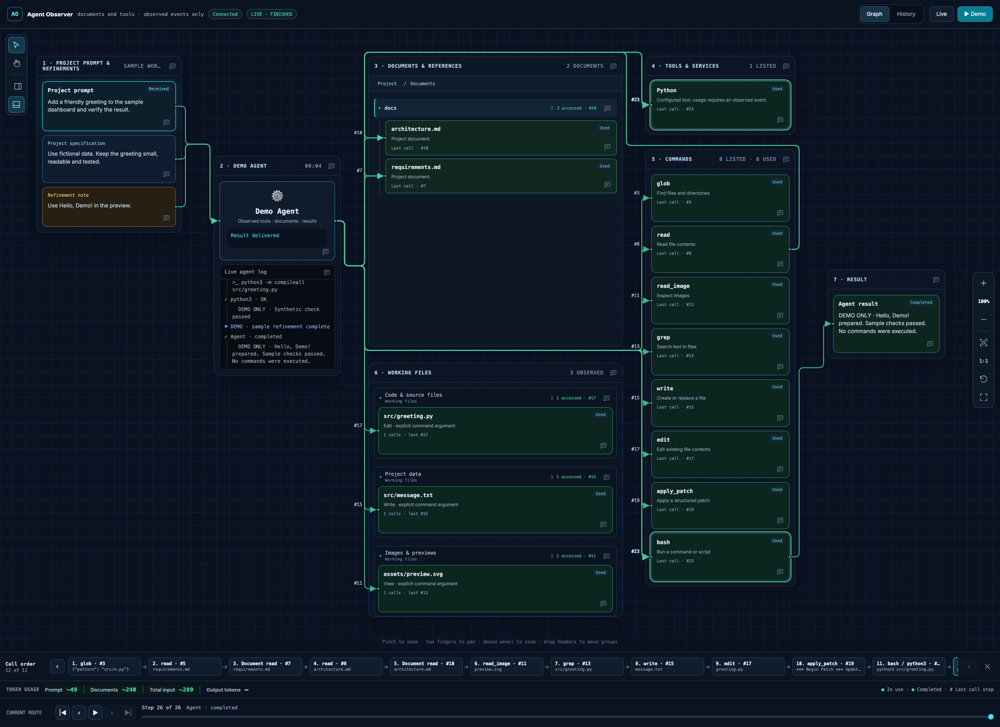

# Agent Observer

A local, interactive graph of an AI agent's workflow, from the request and requirements to tool calls and the final result. It shows interactions recorded by agent events.

- Highlights tool calls, successful actions, and errors.
- Documents, native commands, external services, MCP servers, skills and working files in one graph.
- Request history and step-by-step route replay.
- Token tracking with separate estimates and provider-reported usage.



The document category is based on a project **knowledge base**: Markdown notes with YAML descriptions and Obsidian links. Projects share a structure but keep their own content; the knowledge base grows as the agent works. Example structure (other folders are supported too):

```text
docs/knowledge/
├── ContentStrategy.md
├── Audience.md
├── Decisions.md
├── ideas/
│   └── ContentIdeas.md
├── publication/
│   └── PublicationQueue.md
└── analytics/
    └── Performance.md
```

See [AGENTS.md](AGENTS.md) for installation, startup, and configuration.

## Connect Codex & Project Agents

Use the header's **Agent connections** button. Save or pin the project folder, then connect one of two modules:

- **Project agent**: Connects to the project's own agent. Its model, router, and authentication stay entirely within that agent.
- **Codex Desktop / CLI**: Reads that folder's existing Codex session journals. Continue working in the normal application or CLI; Observer does not launch a replacement Codex.

## Command Observation & Unification

Observer visualizes command execution and tool calls for both project agents and Codex:
- `read` (file reading, internal URIs, and resource loading)
- `write` (file creation and atomic replacement)
- `edit` / `patch` (content patching and modifications)
- `bash` / `shell` (terminal commands and script execution)
- `search` / `grep` (content pattern search)
- `glob` (file and directory discovery)
- `image` (visual inspection and dimensions)
- and more depending on connected tools, MCP servers, or agent skills. Extensible command set: additional operations appear dynamically based on the connected tools and integrations configured in the agent.
